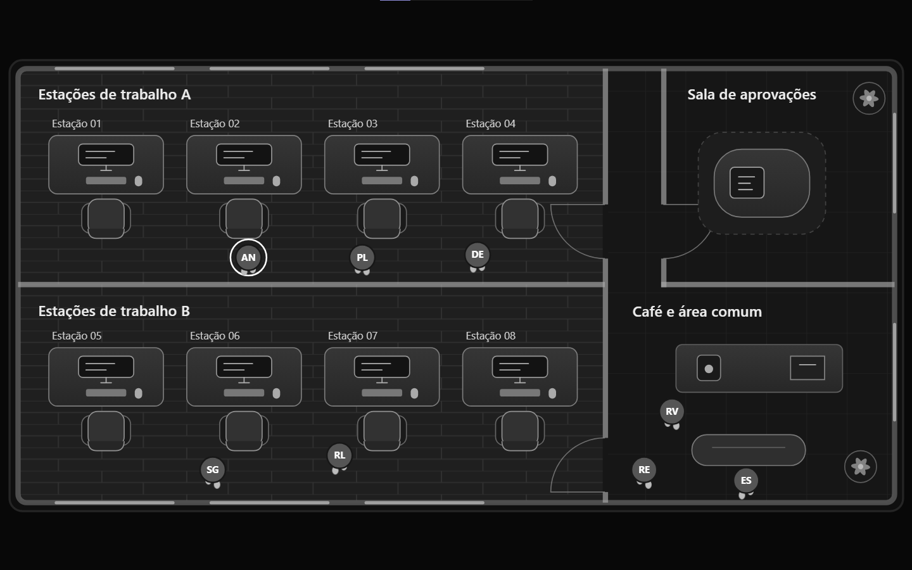
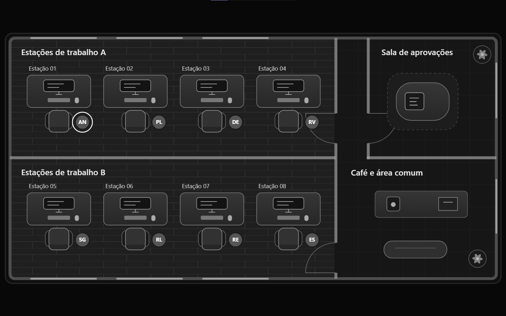
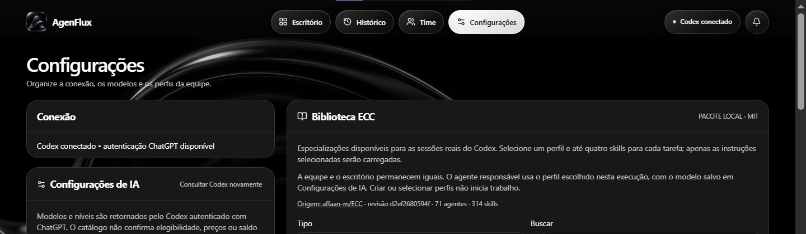

# AgenFlux

Painel local para montar times de agentes, acompanhar missões do Codex e visualizar a equipe em um escritório animado. Use a aba **Time** para escolher até oito agentes próprios ou da biblioteca ECC.

## Interface

O projeto combina um painel operacional, um escritório visual de agentes e uma biblioteca ECC para organizar o fluxo de trabalho em um único lugar.

### Telas do aplicativo

<p align="center">
  
</p>

<p align="center">
  
</p>

<p align="center">
  
</p>

<p align="center">
  
</p>

As imagens mostram o escritório visual, as estações dos agentes, a sala de aprovações, o acompanhamento da equipe e a biblioteca ECC integrada.

## Em computadores mais modestos

O AgenFlux é uma boa opção para computadores com recursos limitados: roda localmente, não depende de banco externo e executa as tarefas em sequência. O computador ainda precisa rodar o Node.js, o navegador e os comandos autorizados.

## Instalação

Você precisa do **Node.js 24 ou superior**, com npm. Para executar tarefas reais, instale também o [Codex CLI](https://developers.openai.com/codex/cli/) e entre com sua conta do ChatGPT.

Baixe ou clone o repositório, abra um terminal na pasta que contém `package.json` e execute:

```sh
npm ci
codex login
npm run dev
```

Abra [http://127.0.0.1:3000](http://127.0.0.1:3000) e clique em **Conectar Codex**. Para testar a interface sem uma conta conectada, pule o login e use **Demonstração → Simular aprovação**.

## Como usar

1. Em **Time**, monte a equipe e escolha **Salvar time e aplicar**. A ordem de seleção define a ordem de execução de uma missão personalizada.
2. Em **Nova missão**, selecione o time, informe o objetivo e indique o caminho da pasta do seu projeto. Os agentes atuam em sequência e o último consolida a entrega.
3. Acompanhe o escritório e revise pedidos de aprovação antes de responder. Consulte o resultado em **Histórico**.
4. Em **Configurações**, consulte modelos e níveis disponíveis na sua conta. A **Biblioteca ECC** também permite pesquisar agentes e adicionar perfis ao catálogo ou diretamente ao escritório.

O servidor escuta apenas no computador local. A execução usa sua sessão local do Codex e os limites da sua conta. O banco SQLite fica em `data/`. Mantenha essa pasta ao atualizar para preservar seu histórico e seus times. A subpasta `data/packages/ecc/` faz parte do código distribuído e contém os perfis da biblioteca.

## Bom para computadores fracos

O AgenFlux foi preparado para rodar localmente, sem banco de dados externo, sem serviços em nuvem e sem uma infraestrutura pesada. A interface usa uma única aplicação local e o histórico fica em SQLite. Ainda assim, para executar missões reais, o consumo de memória dependerá do Node.js, do Codex CLI e dos processos que você delegar.

## Diagnóstico e testes

```sh
npm run doctor
npm run typecheck
npm test
npm run build
```

Se trocar arquivos do servidor, encerre a instância com **Ctrl+C** e execute `npm run dev` novamente. Se a porta 3000 estiver ocupada, defina a variável de ambiente `PORT` antes de iniciar.

## Biblioteca ECC

O material de terceiros vem de [affaan-m/ECC](https://github.com/affaan-m/ECC/tree/d2ef2680594f9a17526a6e1a2e18b3d242c5d17b). O aviso de licença MIT do pacote está em [data/packages/ecc/source/LICENSE](data/packages/ecc/source/LICENSE).
