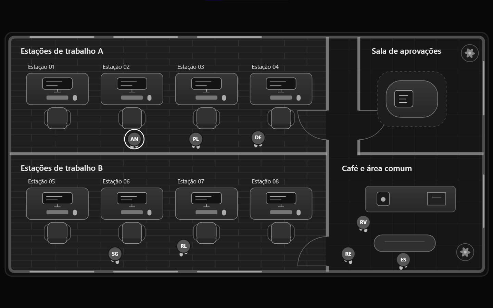
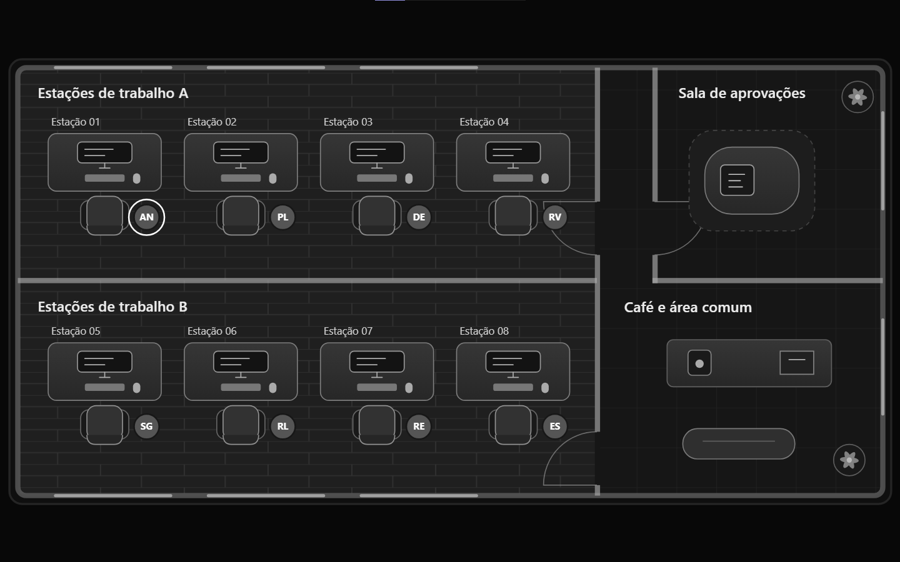
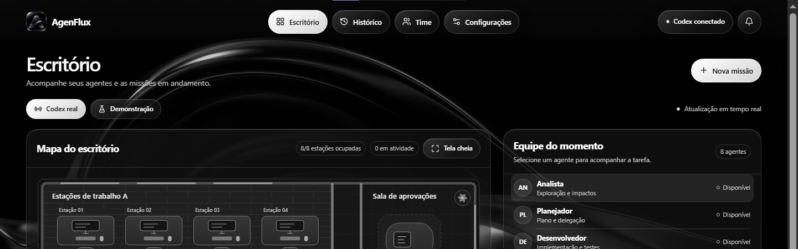
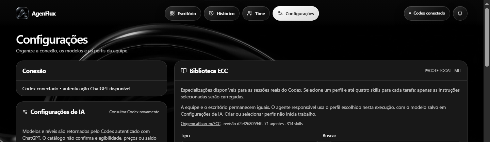

# AgenFlux

Central local de agentes de IA: você escreve uma missão, o **Orquestrador** escolhe agentes, modelos gratuitos e skills, e você acompanha tudo em um escritório RPG em pixel art — cada movimento corresponde a uma execução real.

## Interface

O projeto combina um painel operacional, um escritório visual de agentes e uma biblioteca ECC para organizar o fluxo de trabalho em um único lugar.

### Telas do aplicativo

<p align="center">
  
</p>

<p align="center">
  
</p>

<p align="center">
  
</p>

<p align="center">
  
</p>

> As imagens acima são da versão 2. A versão 3 trocou o mapa por um escritório em pixel art; capture novas telas quando quiser atualizar esta seção.

## O que há na versão 3

- **Orquestrador**: interpreta a missão, mede a complexidade, escolhe agentes, modelo por etapa e até 3 skills por etapa — sem gastar tokens no planejamento e mostrando o motivo de cada escolha. Você pode substituir qualquer decisão.
- **Modelos gratuitos primeiro**: “Somente modelos gratuitos” vem ligado. Nada pago é usado como alternativa.
- **Motores**: OpenCode (recomendado; modelos gratuitos com ferramentas), Ollama (local) e Codex (opcional, usa a assinatura ChatGPT).
- **Oito agentes**: Orquestrador, Analista, Planejador, Desenvolvedor, Revisor, Segurança, Documentador e Testador — e os que você criar.
- **Escritório RPG 2D**: personagens caminham até a estação, trabalham, vão à sala de aprovações e voltam à área comum conforme o estado real das tarefas.
- **Skills** no formato `SKILL.md`, com inspeção de segurança antes de instalar skills externas.
- **Automações**: missões agendadas (uma vez, dias/horário fixos ou a cada intervalo).
- **Aprovações**: comandos, edições e acesso à rede esperam a sua decisão.

## Instalação (Windows, PowerShell)

Você precisa do **Node.js 22.18 ou superior** (desenvolvido e testado no Node 22; o 24 também serve).

```powershell
npm ci
```

```powershell
npm run dev
```

Abra http://127.0.0.1:3000. Para executar missões com IA, conecte um motor em **Modelos e Provedores** — o passo a passo está em [docs/GUIA-OPENCODE-WINDOWS.md](docs/GUIA-OPENCODE-WINDOWS.md) e também dentro do aplicativo.

> **Atualizando da versão 2:** rode `npm ci` de novo (a pasta `node_modules` deixou de ser versionada). Seu banco em `data/` é preservado; uma cópia `agent-hq.pre-v3.sqlite` é criada antes da migração.

## Como usar

1. **Modelos e Provedores** → conecte o OpenCode e teste um modelo gratuito.
2. **Nova missão** → descreva o que precisa e clique em **Analisar missão**. Revise o plano (agentes, modelos, skills) e **Iniciar missão**.
3. Acompanhe no **Escritório**; clique em um personagem para ver modelo, skills, etapa, atividades e arquivos.
4. Decida as **Aprovações** quando aparecerem.
5. Leia o relatório em **Missões** ou **Histórico**. Se algo falhar (limite de uso, desconexão), use **Retomar missão**.

Outras abas: **Equipes** (times fixos), **Agentes** (instruções, modelo, alternativo, raciocínio, skills, personagem), **Skills**, **Automações** e **Configurações** (execuções simultâneas, velocidade do escritório, demonstração).

## Em computadores modestos

Roda localmente com SQLite, sem serviços de nuvem. O escritório usa Canvas 2D sem bibliotecas de jogo e reduz a taxa de quadros quando nada se move. Comece com 1 ou 2 execuções simultâneas.

## Documentação

- [Guia do OpenCode no Windows](docs/GUIA-OPENCODE-WINDOWS.md)
- [Modelos gratuitos: o que foi verificado](docs/MODELOS-GRATUITOS.md)
- [Arquitetura](docs/ARQUITETURA.md)
- [Origem e licença dos assets](docs/ASSETS.md)

## Diagnóstico e testes

```powershell
npm run typecheck
```

```powershell
npm test
```

```powershell
npm run build
```

Os testes de integração com o OpenCode iniciam o binário real quando ele está instalado (ou em `OPENCODE_BIN`) e usam um modelo roteirizado local, sem rede e sem custo; sem o OpenCode, são pulados com aviso. `npm run doctor` continua verificando o Codex.

O servidor escuta apenas no computador local. Se a porta 3000 estiver ocupada, defina `PORT` antes de iniciar.

## Biblioteca ECC

O material de terceiros vem de [affaan-m/ECC](https://github.com/affaan-m/ECC/tree/d2ef2680594f9a17526a6e1a2e18b3d242c5d17b) (MIT). O índice `catalog.json` é reconstruído automaticamente a partir dos arquivos presentes em `data/packages/ecc/source/`.
